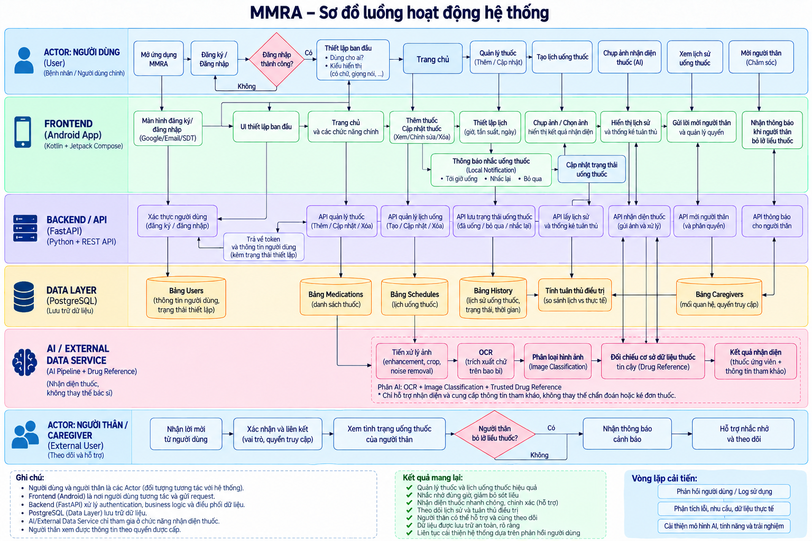

                                        ĐỒ ÁN MÔN HỌC: LẬP TRÌNH THIẾT BỊ DI ĐỘNG 
                                    Nhóm J: Ứng dụng hỗ trợ nhắc nhở uống thuốc - MMRA 
                                      (Medication Management and Reminder Assistant)  

# 1. Thông tin nhóm:
- GVHD: Trương Quang Tuấn
- Thành viên nhóm:

        079306029517_Bùi Ngọc Trang

        084306002719_Thái Thanh Trúc

        052206007572_Đặng Phạm Gia Huy 
# 2. Giới thiệu tổng quan về đề tài:
MMRA (Medication Management and Reminder Assistant) là ứng dụng di động hỗ trợ người dùng quản lý việc sử dụng thuốc, đặc biệt hướng đến người lớn tuổi, người đang phải sử dụng thuốc theo lịch và người thân chăm sóc từ xa.

# 3. Đối tượng nghiên cứu:
Người dùng chính:
- Người lớn tuổi.
- Người phải sử dụng nhiều loại thuốc.
- Người thường xuyên quên lịch uống thuốc.

Người dùng liên quan / Caregiver
- Con cái.
- Người thân.
- Người chăm sóc người sử dụng thuốc.
# 4. Các tính năng chính:
- Nhắc nhở uống thuốc thông minh
- Nhận diện & Sắp lịch thuốc
- Theo dõi & Xác nhận
- Kết nối gia đình
# 5. Công nghệ sử dụng:
- Công cụ quản lý mã nguồn: Github

Mobile – Android App
công nghệ frontend của MMRA:
- Kotlin – ngôn ngữ lập trình Android.
- Android Studio – môi trường phát triển.
- Jetpack Compose – xây dựng giao diện.
- Navigation Compose – điều hướng giữa các màn hình.
- Retrofit / OkHttp – dự kiến dùng để Android giao tiếp với FastAPI Backend thông qua REST API.
- Coroutines – xử lý các tác vụ bất đồng bộ như gọi API.
- CameraX – dự kiến sử dụng cho chức năng chụp ảnh thuốc.
- Room – dự kiến dùng để lưu dữ liệu cục bộ/offline trên thiết bị.
- AlarmManager / WorkManager – dự kiến dùng cho cơ chế lập lịch và nhắc uống thuốc.
- Android Notification – hiển thị thông báo nhắc uống thuốc.

Backend

Phần server phía sau ứng dụng:
- Python – dự kiến sử dụng để làm ngôn ngữ lập trình Backend.
- FastAPI – xây dựng REST API.
- Pydantic – dự kiến sẽ sử dụng để kiểm tra và validate dữ liệu request/response.
- SQLAlchemy – dự kiến sử dụng để kết nối và thao tác với Database.
- PostgreSQL – dự kiến sử dụng làm cơ sở dữ liệu chính.
- JWT – dự kiến sử dụng để xác thực người dùng và quản lý phiên đăng nhập.

AI

Công nghệ phục vụ chức năng nhận diện thuốc bằng hình ảnh:
- Python – dự kiến sẽ là ngôn ngữ xử lý AI.
- PyTorch / TensorFlow – dự kiến sẽ là framework xây dựng hoặc huấn luyện model.
- OpenCV – dự kiến dùng để xử lý hình ảnh.
- NumPy – dự kiến dùng để xử lý dữ liệu số.
- OCR – dự kiến dùng để đọc chữ trên bao bì thuốc.
- Image Classification – dự kiến sử dụng để phân loại thuốc từ hình ảnh.
- MobileNet / EfficientNet hoặc mô hình phù hợp – mô hình CNN/transfer learning dự kiến sử dụng cho nhận diện hình ảnh.

# 4.	Hướng dẫn chạy chương trình
